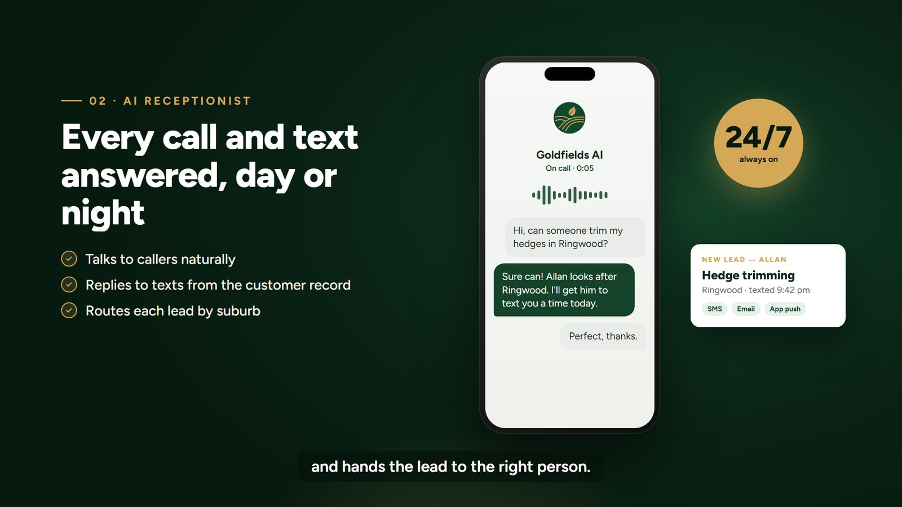
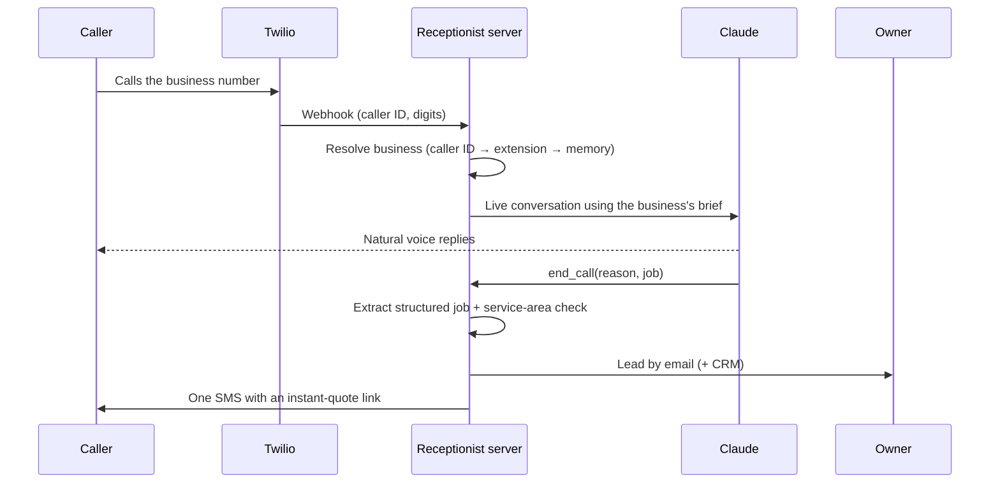

# AI receptionist: phone and chat for small businesses

**Live:** [aiwithoutjargon.com.au/ai-receptionist](https://aiwithoutjargon.com.au/ai-receptionist/)

A multi-tenant AI receptionist I built and run for trade businesses. It answers calls, texts and website chat in each business's own name, talks naturally, captures the job, checks it's inside the service area, and hands a clean lead to the owner by email and SMS. The customer gets a follow-up text with a link to an instant quote.

> The source code is private because it runs for live businesses. This repo is a write-up. I'm happy to walk through the code on a call.

---

## What it does

- **Answers as the business.** Each business has a brief covering services, suburbs, hours, prices and tone. The receptionist speaks for them and never says "which business are you calling?"
- **One number, many businesses.** A single phone number serves every demo business. Callers are matched by caller ID, by a silent extension the website's Call button dials automatically, or by caller memory. Paying clients get their own local number.
- **Recognises returning callers,** so they're put straight through to the right business.
- **Ends the call properly.** A structured `end_call` tool records why the call ended and what job was asked for.
- **Clean leads after every call.** The transcript is turned into a structured job (service, suburb, urgency, contact details), checked against the service area, saved, pushed into the CRM, and emailed to the owner. The caller gets one SMS with a quote link.
- **Website chat too.** The same brain powers a chat widget on the business's website.
- **Respects the owner's settings.** Business hours, transfer-to-a-human rules and answering modes can be set per business.

## How a call flows

## Engineering notes

- **Per-business prompt caching** keeps responses fast and running costs low, on a small, quick model.
- **Webhook signature validation** on every Twilio request.
- **Hot-reloaded tenant registry:** add a business by dropping in its brief, with no restart.
- **Cost tracking per call,** so per-call fees can flow onto the client's monthly invoice.
- **Tested with a mock model,** so call logic can be tested without paying for real calls.

## Built with

Node.js · Twilio Voice and SMS · Claude (Anthropic) · SQLite (`node:sqlite`) · Caddy · pm2 · a Linux VPS

---

**Want calls, texts or chat answered for your business?** Get in touch through my profile.
